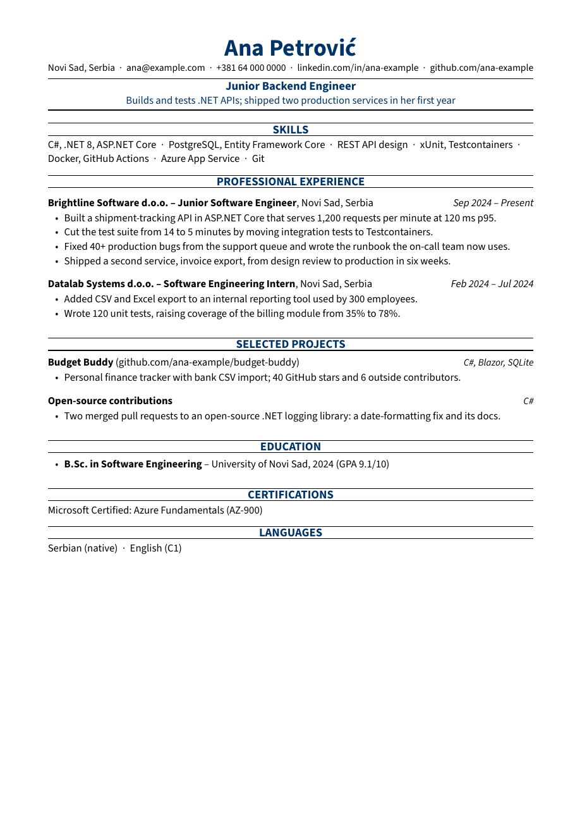
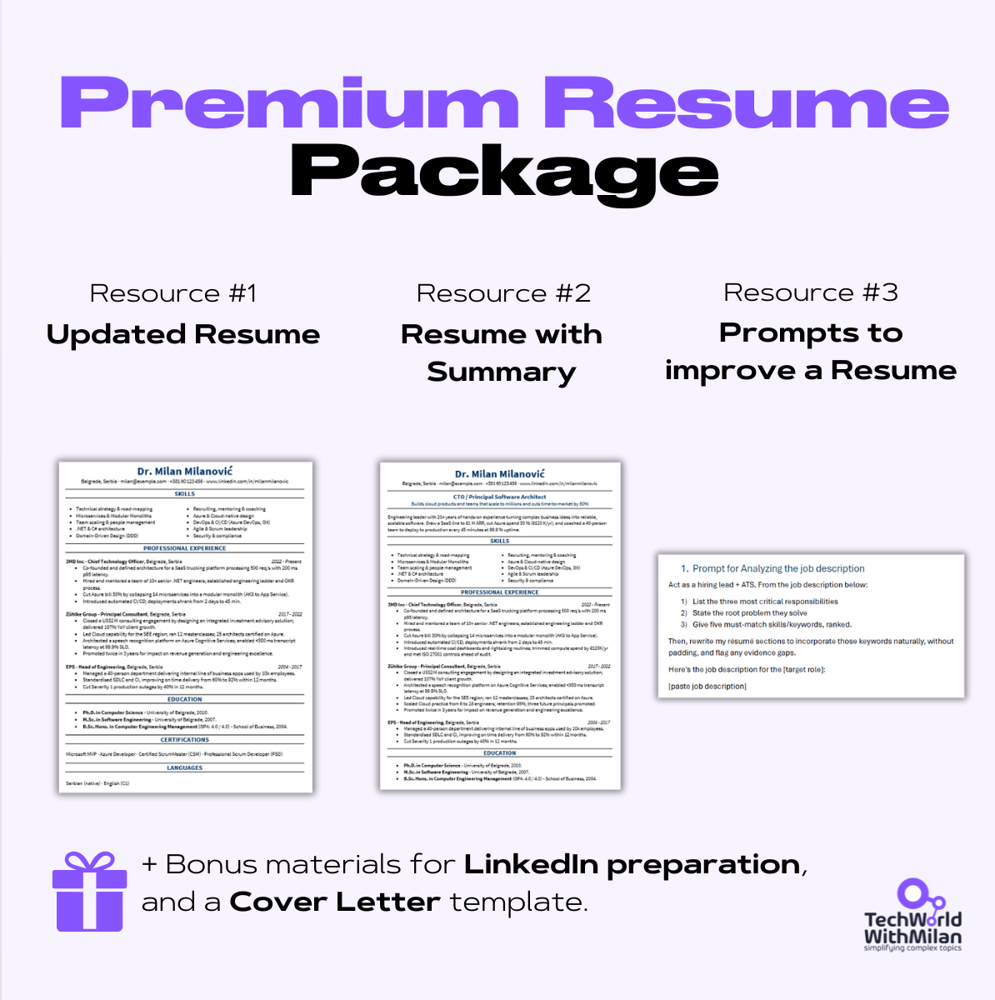

# Milanovic Resume

[](https://github.com/milanm/Milanovic-Resume/actions/workflows/build.yml)
[](LICENSE)
[](fonts/OFL.md)

A one-page, single-column resume template for software engineers, in **LaTeX and Typst**.

I have reviewed 1,000+ resumes as a hiring manager, and I've seen many fail for similar reasons. They usually have too many pages or complex two-column layouts that confuse the applicant tracking system (ATS), or a PDF where a search for "cloud-native" finds nothing. This template follows those rules, and CI checks that it keeps following them.


<p align="center">
  
  
  
</p>

**[Create your resume in Overleaf](https://www.overleaf.com/docs?snip_uri=https://github.com/milanm/Milanovic-Resume/releases/latest/download/Milanovic-Resume-overleaf.zip&engine=lualatex&main_document=template.tex)** · [Open the filled example in Overleaf](https://www.overleaf.com/docs?snip_uri=https://github.com/milanm/Milanovic-Resume/releases/latest/download/Milanovic-Resume-overleaf.zip&engine=lualatex&main_document=resume.tex) · [Example PDF (LaTeX)](pdf/resume-latex.pdf) · [Example PDF (Typst)](pdf/resume-typst.pdf)

## What you get

| | |
|---|---|
| `latex/resume.tex` | My own resume, as a filled-in example |
| `latex/template.tex` | Starter with placeholders and a projects section |
| `latex/cover-letter.tex` | Cover letter in the same style |
| `latex/junior.tex` | A junior engineer's resume (made-up person): no summary, projects up front |
| `typst/*.typ` | The same four documents in Typst |
| `scripts/` | The checks CI runs on every commit (text layer, ATS fields, edge cases, page renders) and a one-off test against commercial resume parsers |
| `tests/` | What the checks compare against: expected field values, reference renders, parser results |

## How it differs from most resume templates

| | This template | Typical LaTeX resume template |
|---|---|---|
| Layout | One column, skills included (one line, separated by dots). CI checks with poppler that your headings and a line from each section come out in page order | Often two columns, read in an unpredictable order |
| Length | CI fails the build on a second page, for both engines. The LaTeX class also warns in the log while you write (Typst has no such warning) | No limit |
| Text layer | Tested on every commit with poppler and pdfminer.six, both engines: no ligature glyphs, real hyphens, `ć` and `ü` intact | Untested |
| ATS fields | CI checks with three extractors that each job's company, title and dates come out together. Three commercial parsers tested once ([results](#commercial-parsers)) | Untested |
| Accessibility | Tagged PDF with real headings: PDF/UA-2 from LaTeX, PDF/UA-1 from Typst, both validated with veraPDF on every commit | Untagged |
| Edge cases | Long names and links, US Letter, 10 and 12 pt and a resume that overflows are built and checked on every commit, plus a pixel comparison of page 1 of every PDF | Untested |
| Font | Source Sans 3, open license, bundled. Same result on Windows, macOS, Linux and Overleaf | System or Mac-only fonts |
| Engines | LaTeX (LuaLaTeX) and Typst, same design | LaTeX only |
| Settings | Paper, accent colour, font size and ligatures are class options | Edit the style file |
| Cover letter | Included, matching style | Rarely |

I initially compiled the template with XeLaTeX, only to find that it converted every regular hyphen to a non-breaking hyphen (U+2011) and didn't use actual space characters between words in the generated PDF. Searching for "cloud-native" returned nothing, and pypdf extracted my entire summary as a single word. Switching to LuaLaTeX and generating a tagged PDF fixed both, and poppler, pdfminer.six and pypdf now agree on the word count (428). pdfminer.six still re-orders centred headings with its layout-based heuristic, which happens with any resume template, so CI uses pdfminer.six to check the text layer and poppler to check reading order.

### Which engine should I use?

- **Typst** if you want compile times in milliseconds and a single small library file.
- **LaTeX** if you live in Overleaf or already have a TeX setup.

Both produce the same page, the same text for parsers, and a tagged PDF that passes veraPDF.

## Quick start

### Overleaf (nothing to install)

1. Click **[Create your resume in Overleaf](https://www.overleaf.com/docs?snip_uri=https://github.com/milanm/Milanovic-Resume/releases/latest/download/Milanovic-Resume-overleaf.zip&engine=lualatex&main_document=template.tex)**. It opens `template.tex` with placeholders; my filled example is `resume.tex` in the same project.
2. Check that **Menu → Compiler** says **LuaLaTeX**.
3. Replace the placeholders and keep an eye on the log: the class warns as soon as you spill onto page 2.

### LaTeX on your machine

Needs a current TeX Live or MiKTeX with `latexmk` (CI uses the latest TeX Live). Prefer XeLaTeX? Delete the `\DocumentMetadata` line at the top of the file first, because XeTeX can't make a tagged PDF.

```bash
cd latex
latexmk resume.tex      # latexmkrc already selects LuaLaTeX
```

### Typst

Needs Typst 0.14 or newer. On [typst.app](https://typst.app), upload `lib.typ`, `template.typ` and the fonts from `fonts/`.

```bash
cd typst
typst compile --font-path ../fonts --pdf-standard ua-1 template.typ   # starter; resume.typ is the filled example
```

`--pdf-standard ua-1` produces a tagged, accessible PDF/UA-1. Typst bails out with an error if anything violates the spec, for example an image with no alt text.

A Typst Universe package (`typst init @preview/milanovic-resume`) is in review at [typst/packages#6333](https://github.com/typst/packages/pull/6333). Until it is merged, use the files above.

### Everything at once

```bash
make            # builds all PDFs into pdf/, runs the text and field checks
make edge       # long names, US Letter, 10 and 12 pt, overflow
make verapdf    # PDF/UA validation (needs Docker)
make visual     # page 1 of every PDF against tests/visual
make previews   # renders images/*.png for this README
```

## Customize

### Options

```latex
\documentclass[paper=letter, accent=1F4E79, fontsize=10.5]{milanovic-resume}
```

| Option | Default | Values |
|---|---|---|
| `paper` | `a4` | `a4`, `letter` |
| `accent` | `003366` | any hex colour, without the `#` |
| `fontsize` | `11` | points (`10.5` or `10.5pt`); go down to 10 before you cut content you need |
| `ligatures` | `false` | `true` turns on "fi"/"fl" ligatures (prettier, harder to parse) |
| `onepage` | `true` | `false` silences the page-2 warning |

Typst takes the same settings as arguments: `paper: "us-letter"`, `accent: rgb("#1F4E79")`, `font-size: 10.5pt`, `ligatures: true`.

### Building blocks

| LaTeX | Typst | What it does |
|---|---|---|
| `\name{}` `\contact{}` | `name:` `contact:` | Name and contact line. Separate items with `\sep` |
| `\headline{}` `\tagline{}` | `headline:` `tagline:` | Target role and your strongest result |
| `\keywords{}` | `keywords:` | Written to the PDF metadata |
| `\summary{}` | `#summary[]` | Short paragraph under the header |
| `\section{}` | `= Heading` | Centred section heading with rules |
| `skills` environment | `#skills(..)` | Skills on one line, separated by dots. `\begin{skills}[columns]` or `columns: true` gives a two-column bullet list; pdfminer.six reads its left column before the heading |
| `\job{Company}{Title}{Location}{Dates}` | `#job("Company", title:, location:, dates:)` | Position header, bullets follow |
| `\project{Name}{Link}{Stack}` | `#project("Name", info:, stack:)` | Project header, bullets follow |
| `\education{Degree}{School}{Year}` | `#education("Degree", school:, year:)` | Education line inside a list |
| `\inline{A \sep B}` | `#inline[A][B]` | Certifications, languages |
| `letter` environment | `#letter(..)` | Cover letter body |

## The checks

### Text layer

`scripts/check_pdf.py` reads the PDF the way a parser does, with poppler's `pdftotext`, and fails when:

- the PDF has more than one page,
- fewer than 50 words come out (a blank or image-only PDF),
- the text contains ligature glyphs, look-alike hyphens, soft hyphens, replacement or private-use characters,
- the strings you pass to `--expect` come out in a different order (use your headings plus a line from each section),
- a string you pass to `--contains` (your email, a key skill) does not survive extraction.

```bash
python3 scripts/check_pdf.py pdf/resume-latex.pdf --expect "Your Name" SKILLS "PROFESSIONAL EXPERIENCE" EDUCATION --contains "you@example.com" --show
python3 scripts/check_pdf.py pdf/resume-latex.pdf --parser pdfminer --contains "you@example.com"   # needs: pip install pdfminer.six
```

### Fields

`scripts/check_fields.py` verifies the output of poppler, pdfminer.six and PyMuPDF against `tests/fields/resume.yml` and `tests/fields/junior.yml`. It fails if the name, email, phone number, location, a skill, a certification or a language is missing, or if a job's title, dates or location isn't found between the company of that job and the company of the following job. A parser can attach a title to a company only if the two come out together.

### Commercial parsers

These open-source extractors aren't what an ATS runs. `scripts/ats_parsers.py` queries three commercial resume parsers via [Eden AI](https://www.edenai.co) and counts the fields each one puts in the correct slot, such as a job title under the right company rather than somewhere else in the output. I ran it on November 8, 2026. The raw responses are stored in `tests/ats/`. A fourth parser, Senseloaf, was down on Eden AI that day.

| PDF | Affinda | Extracta | Klippa |
|---|---|---|---|
| `resume-latex.pdf` | 20/22 | 22/22 | 19/22 |
| `resume-typst.pdf` | 20/22 | 22/22 | 19/22 |
| `junior-latex.pdf` | 13/14 | 14/14 | 14/14 |
| `junior-typst.pdf` | 13/14 | 14/14 | 14/14 |

All three parsers correctly identified the name, email, phone number, location, and the company, title, start date and end date for every job. Every miss is a degree name. Affinda places the degree level ("Master") in the degree field and truncates the degree name ("M.Sc. in"). Klippa doesn't return a degree name for my resume, but it does for the junior resume, which uses the exact same layout. Both engines get the same scores, which suggests the parsers are at fault, not the layout.

Each PDF costs about $0.27 in Eden AI credits, so the test doesn't run in CI:

```bash
export EDENAI_API_KEY=...   # your own key
python3 scripts/ats_parsers.py pdf/resume-latex.pdf tests/fields/resume.yml --save tests/ats/resume-latex.json
```

### Edge cases

`scripts/edge_cases.py` generates six variations of the example resume with both engines: US Letter, 10 pt, 12 pt, a long hyphenated name with a long LinkedIn URL, the skills section as a two-column list, and the experience section repeated three times. In all of them the text must stay within the margins, and in LaTeX the document must compile without an overfull line. For the overflow variant, the one-page check must fail and the LaTeX class must warn about page 2.

### Accessibility

Both engines produce a tagged PDF. Section headings are tagged as headings, so a screen reader can jump between them. Lists are tagged as lists, and the horizontal rules are marked as decoration. CI checks every PDF with [veraPDF](https://verapdf.org): PDF/UA-2 for the LaTeX PDFs and PDF/UA-1 for the Typst ones (Typst 0.14 doesn't support PDF/UA-2). veraPDF can verify only what a computer can verify. The reading order is a human check, and so is whether the link text means something.

### Visual regression

`scripts/visual_diff.py` renders page 1 of every PDF and compares it to the reference images in `tests/visual/`. If more than 0.5% of the pixels change, the build fails, since that usually means text has moved or the spacing has broken. Changing a word doesn't fail it. After a change to the design, run `make baseline` and commit the new reference images.

### Run the checks on your own resume

`make check` and CI search for my name, my example email address and the sample letter's greeting. When you put in your own details, update `RESUME_ORDER`, `RESUME_HAS`, `TEMPLATE_ORDER` and `LETTER_ORDER` at the top of the `Makefile`, and put your information in `tests/fields/resume.yml`. Run `make baseline` to update the reference renders, or copy the `build/visual/*.png` files from the CI build artifact to `tests/visual/`; otherwise the build fails. The items in an `*_ORDER` variable must appear in the listed order. `MAX_PAGES` is set to 1. If your experience needs two pages, increase `MAX_PAGES` (and set `onepage=false` in LaTeX to silence the page-2 warning).

Always run the checks on your own PDF before you send it. `--show` prints what the parser sees. A few parsers don't cover every ATS on the market, so take a passing check as a good sign, not a guarantee.

## Writing rules that go with the template

The template fixes the format. The content is still on you.

1. **One page.** Even ten years of experience fits on one page if you keep only what matters for the role.
2. **Impact first.** "Responsible for the authentication service" can become "Cut login failures by 40% by rebuilding auth with Redis caching".
3. **Verb first.** The first 2-3 words of a bullet are what recruiters read first: Built, Led, Cut, Scaled.
4. **No buzzwords.** Describe what you did and its impact instead.
5. **Use the job post's words.** Mirror the job posting where it fits, but only for skills and experience you actually have.
6. **The top third decides.** Spend most of your time polishing the first third of your resume: headline, summary, and your first or most relevant position.
7. **Proofread.** A typo on your resume is like a bug in production.
8. **One column, plain formatting.** Avoid two-column resumes and fancy formatting that confuse applicant tracking systems.
9. **Full names, consistent dates.** Write job titles and company names in full, with the company's legal form (Inc., LLC, GmbH). [Greenhouse lists](https://support.greenhouse.io/hc/en-us/articles/200989175-Unsuccessful-resume-parse) abbreviated titles and company names among the causes of parsing problems. Use one date format everywhere, such as "Mar 2023 – Present".

## Want the Word and Google Docs version?

<a href="https://www.patreon.com/techworld_with_milan/posts/premium-resume-174690977"></a>

This repo is the free LaTeX and Typst template. The **[Premium Resume Package](https://www.patreon.com/techworld_with_milan/posts/premium-resume-174690977)** also includes:

- Word versions of the resume templates (they also open in Google Docs)
- Variations with and without a summary, and with a projects section
- A matching cover letter template
- The AI prompts I use when tailoring my resume to a job post
- A video walkthrough
- Short guides on writing your resume and preparing your LinkedIn profile

## Credits and license

- Code and examples: [MIT](LICENSE). The example content is my own resume; replace it with yours.
- Font: [Source Sans 3](https://github.com/adobe-fonts/source-sans) by Adobe, [SIL Open Font License 1.1](fonts/OFL.md).
- The commercial-parser test follows the idea of [RenderCV](https://github.com/rendercv/rendercv)'s ATS tests.
- The repo layout follows the example of [Deedy Resume](https://github.com/deedy/Deedy-Resume), which showed how useful a well-made open resume template can be.

## Changelog

**v1.3.0** (2026-11-08): section headings are tagged as headings in the LaTeX PDF, and the horizontal rules no longer show up as empty paragraphs; Typst now outputs tagged PDF/UA-1; CI validates both engines with veraPDF, checks the company, title and dates of every job with three extractors, generates six edge cases with both engines, and compares page 1 of every PDF with a reference render; results from three commercial resume parsers; CI builds Typst from crates.io when the download from GitHub fails.

**v1.2.0** (2026-11-07): junior engineer example; CONTRIBUTING and issue forms; LaTeX compiles with LuaLaTeX into a tagged PDF/UA-2 file; real hyphens and spaces in the text layer, so poppler, pdfminer.six and pypdf all read it the same; CI runs the pdfminer.six check on both engines; Overleaf links open with LuaLaTeX.

**v1.1.1** (2026-11-07): starter template shows full job titles, company legal forms and "Mon YYYY" dates; `MAX_PAGES` in the Makefile; Dependabot keeps the GitHub Actions current.

**v1.1.0** (2026-11-07): skills default to one line separated by dots (`[columns]` / `columns: true` keeps the two-column list); the build stops at the first compile error and deletes old PDFs first; the check fails on blank or near-blank PDFs and its expected strings are Makefile variables; "Create your resume" Overleaf link opens the starter template.

**v1.0.0** (2026-11-07): first release. LaTeX class and Typst library with the same design, resume, starter and cover letter examples, ATS check in CI with two parsers, Overleaf zip on every release.
