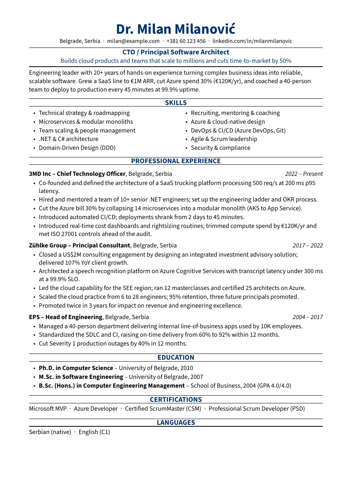
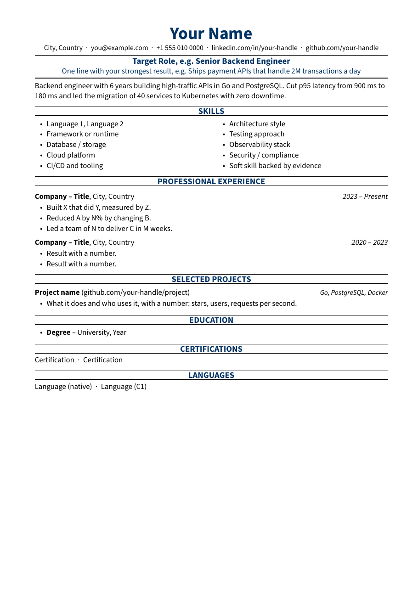
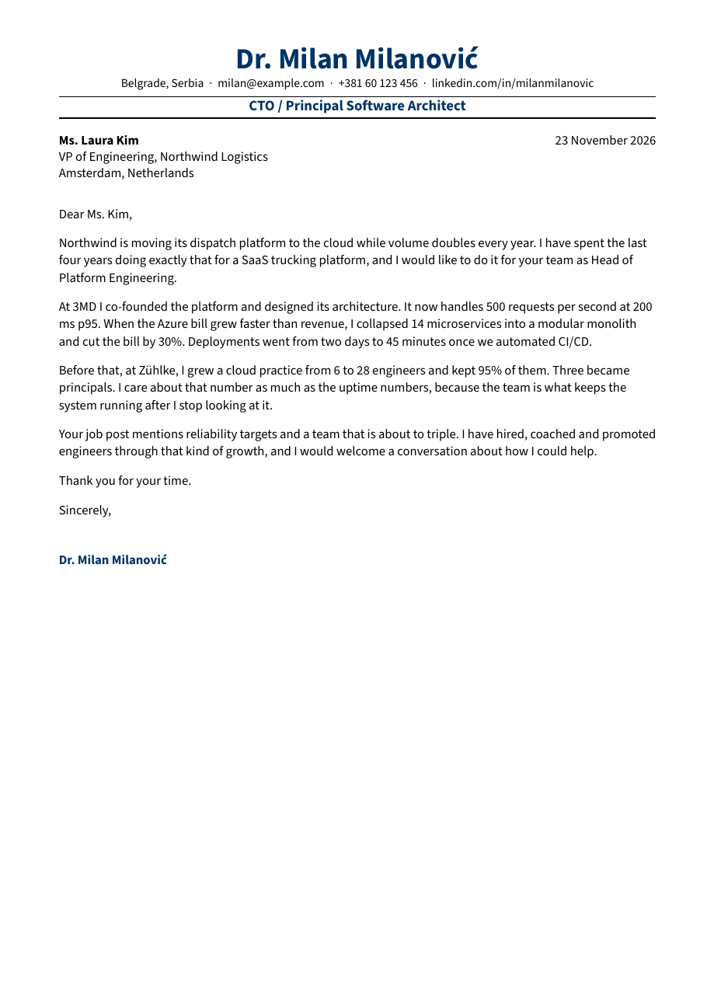

# Milanovic Resume

[](https://github.com/milanm/Milanovic-Resume/actions/workflows/build.yml)
[](LICENSE)
[](fonts/OFL.md)

A one-page, single-column resume template for software engineers, in **LaTeX and Typst**.

I have reviewed more than 1,000 resumes as a hiring manager. Most of them lose on things a template can fix: a second page nobody reads, a two-column layout the applicant tracking system (ATS) scrambles, a PDF where the parser can't find the word "cloud-native". This template has those rules built in, and CI checks them on every commit.



<p align="center">
  
  
</p>

**[Download the PDF (LaTeX)](pdf/resume-latex.pdf)** · **[Download the PDF (Typst)](pdf/resume-typst.pdf)** · **[Open in Overleaf](https://www.overleaf.com/docs?snip_uri=https://github.com/milanm/Milanovic-Resume/releases/latest/download/Milanovic-Resume-overleaf.zip&engine=xelatex&main_document=resume.tex)**

## What you get

| | |
|---|---|
| `latex/resume.tex` | My own resume, as a filled-in example |
| `latex/template.tex` | Starter with placeholders and a projects section |
| `latex/cover-letter.tex` | Cover letter in the same style |
| `typst/*.typ` | The same three documents in Typst |
| `scripts/check_pdf.py` | The ATS check that runs in CI |

## How it differs from most resume templates

| | This template | Typical LaTeX resume template |
|---|---|---|
| Layout | One column. The order you see is the order a parser reads. | Often two columns, read in an unpredictable order |
| Length | Warns in the log when you spill onto page 2. CI fails the build. | No limit |
| Text layer | Tested on every commit: no ligature glyphs, real hyphens, `ć` and `ü` intact. Poppler for both builds, pdfminer.six for the Typst build | Untested |
| Font | Source Sans 3, open license, bundled. Same result on Windows, macOS, Linux and Overleaf | System or Mac-only fonts |
| Engines | LaTeX (XeLaTeX) and Typst, same design | LaTeX only |
| Settings | Paper, accent colour, font size and ligatures are class options | Edit the style file |
| Cover letter | Included, matching style | Rarely |

The text-layer check paid off while I was building this. XeLaTeX wrote every plain hyphen into the PDF as a non-breaking hyphen (U+2011). The page looked right, but a keyword search for "cloud-native" found nothing. The class now adds ActualText hints, so poppler (`pdftotext`) and pdfium read real hyphens. Parsers that ignore those hints, such as pdfminer.six and pypdf, still see U+2011 in the XeLaTeX build. The Typst build is clean in all four, which is why CI runs the stricter pdfminer.six pass on it.

### Which engine should I use?

- **Typst** if you want the cleanest text layer for every parser, and compile times in milliseconds.
- **LaTeX** if you live in Overleaf or already have a TeX setup. Both produce the same page.

## Quick start

### Overleaf (nothing to install)

1. Click **[Open in Overleaf](https://www.overleaf.com/docs?snip_uri=https://github.com/milanm/Milanovic-Resume/releases/latest/download/Milanovic-Resume-overleaf.zip&engine=xelatex&main_document=resume.tex)**.
2. Check that **Menu → Compiler** says **XeLaTeX**.
3. Edit `resume.tex` or start from `template.tex`.

### LaTeX on your machine

Needs TeX Live or MiKTeX with `latexmk`.

```bash
cd latex
latexmk resume.tex      # latexmkrc already selects XeLaTeX
```

### Typst

Needs Typst 0.14 or newer. On [typst.app](https://typst.app), upload `lib.typ`, your `.typ` file and the fonts from `fonts/`.

```bash
cd typst
typst compile --font-path ../fonts resume.typ
```

### Everything at once

```bash
make            # builds all PDFs into pdf/ and runs the ATS check
make previews   # renders images/*.png for this README
```

## Customize

### Options

```latex
\documentclass[paper=letter, accent=1F4E79, fontsize=10.5]{milanovic-resume}
```

| Option | Default | Values |
|---|---|---|
| `paper` | `a4` | `a4`, `letter` |
| `accent` | `003366` | any hex colour, without the `#` |
| `fontsize` | `11` | points (`10.5` or `10.5pt`); go down to 10 before you cut content you need |
| `ligatures` | `false` | `true` turns on "fi"/"fl" ligatures (prettier, harder to parse) |
| `onepage` | `true` | `false` silences the page-2 warning |

Typst takes the same settings as arguments: `paper: "us-letter"`, `accent: rgb("#1F4E79")`, `font-size: 10.5pt`, `ligatures: true`.

### Building blocks

| LaTeX | Typst | What it does |
|---|---|---|
| `\name{}` `\contact{}` | `name:` `contact:` | Name and contact line. Separate items with `\sep` |
| `\headline{}` `\tagline{}` | `headline:` `tagline:` | Target role and your strongest result |
| `\keywords{}` | `keywords:` | Written to the PDF metadata |
| `\summary{}` | `#summary[]` | Short paragraph under the header |
| `\section{}` | `= Heading` | Centred section heading with rules |
| `skills` environment | `#skills(..)` | Two-column bullet list |
| `\job{Company}{Title}{Location}{Dates}` | `#job("Company", title:, location:, dates:)` | Position header, bullets follow |
| `\project{Name}{Link}{Stack}` | `#project("Name", info:, stack:)` | Project header, bullets follow |
| `\education{Degree}{School}{Year}` | `#education("Degree", school:, year:)` | Education line inside a list |
| `\inline{A \sep B}` | `#inline[A][B]` | Certifications, languages |
| `letter` environment | `#letter(..)` | Cover letter body |

## The ATS check

`scripts/check_pdf.py` reads the PDF the way a parser does, with poppler's `pdftotext`, and fails when:

- the PDF has more than one page,
- the text contains ligature glyphs, look-alike hyphens, soft hyphens, replacement or private-use characters,
- the section headings come out in a different order than they appear on the page,
- a string you list (your name, your email) does not survive extraction.

```bash
python3 scripts/check_pdf.py pdf/resume-latex.pdf --expect SKILLS "PROFESSIONAL EXPERIENCE" EDUCATION --contains "your@email.com" --show
python3 scripts/check_pdf.py pdf/resume-typst.pdf --parser pdfminer   # stricter parser, needs: pip install pdfminer.six
```

Run it on your own PDF before you send it anywhere. `--show` prints what the parser sees. Two open-source parsers are not every ATS on the market, so treat a pass as a good sign, not a guarantee.

## Writing rules that go with the template

The template fixes the format. The content is still on you.

1. **One page.** Ten years of work fit on one page if you keep only what matters for the role.
2. **Impact first.** "Cut login failures by 40% by rebuilding auth with Redis caching" beats "Responsible for the authentication service".
3. **Verb first.** Recruiters read the first two or three words of a bullet. Built, Led, Cut, Scaled.
4. **No buzzwords.** Say what you did and what changed.
5. **The top third decides.** Spend most of your editing time on the headline, summary and first job.
6. **Tailor it.** Mirror the job description's words for the skills you really have.
7. **Proofread.** A typo on a resume reads like a bug in production.

## Want the Word and Google Docs version?

This repo is the free LaTeX and Typst template. The **[Premium Resume Package](https://www.patreon.com/techworld_with_milan/shop/premium-resume-package-1721454?source=storefront)** has the editable Word templates (they also open in Google Docs), versions with a summary and with projects, a matching cover letter, the AI prompts I use to tailor a resume to a job post, a video walkthrough, and short guides on writing the resume and preparing your LinkedIn profile.

## Credits and license

- Code and examples: [MIT](LICENSE). The example content is my own resume; replace it with yours.
- Font: [Source Sans 3](https://github.com/adobe-fonts/source-sans) by Adobe, [SIL Open Font License 1.1](fonts/OFL.md).
- The repo layout follows the example of [Deedy Resume](https://github.com/deedy/Deedy-Resume), which showed how useful a well-made open resume template can be.

## Changelog

**v1.0.0** (2026-11-07): first release. LaTeX class and Typst library with the same design, resume, starter and cover letter examples, ATS check in CI with two parsers, Overleaf zip on every release.
